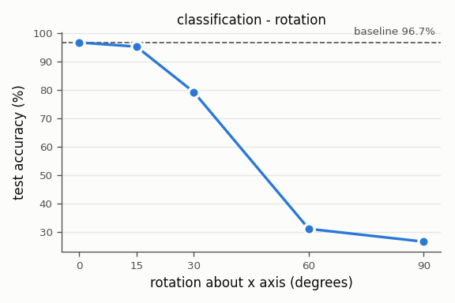
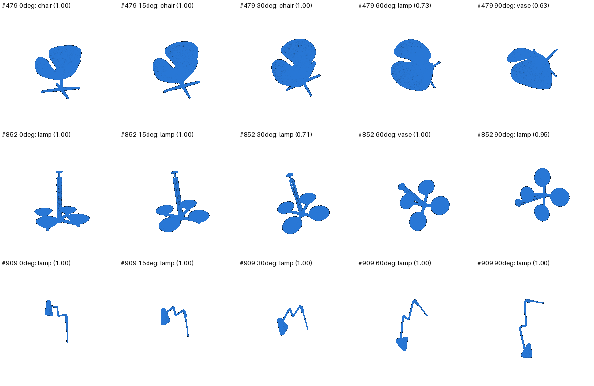
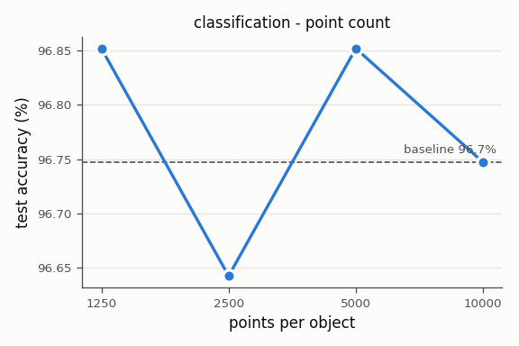
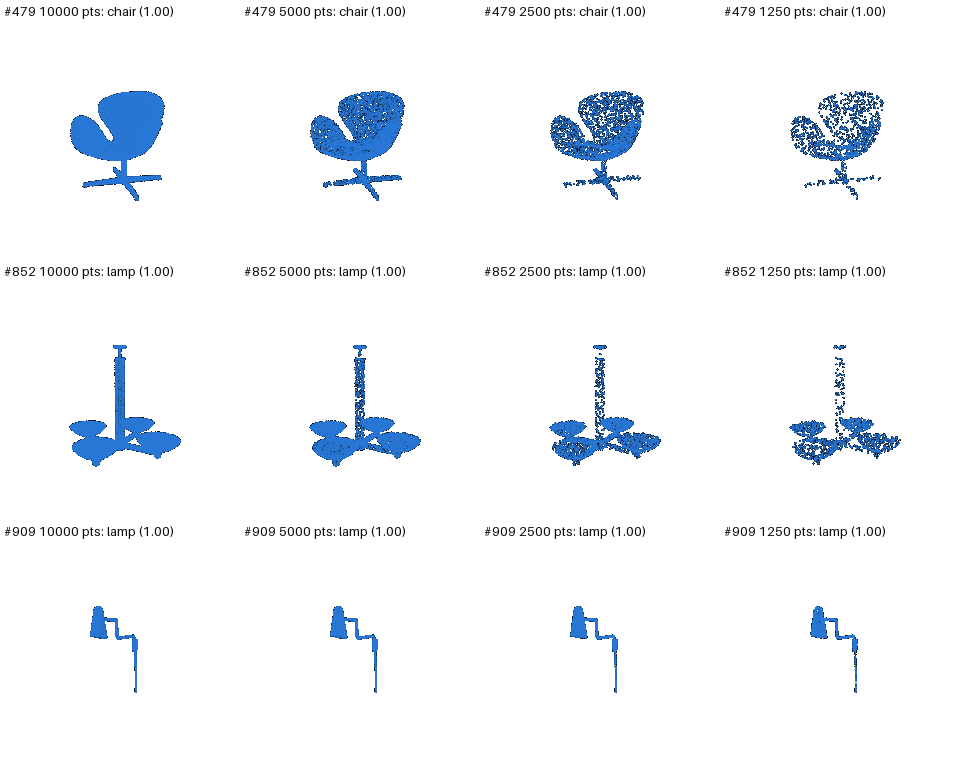

# Q3 robustness - classification

Baseline (no rotation, 10000 points): **0.9675**, checkpoint `./checkpoints/cls/best_model.pt` (epoch 109).

## Rotation about the x axis

| condition | points | accuracy | change (pp) |
|---|---|---|---|
| 0deg | 10000 | 0.9675 | +0.00 |
| 15deg | 10000 | 0.9528 | -1.47 |
| 30deg | 10000 | 0.7922 | -17.52 |
| 60deg | 10000 | 0.3106 | -65.69 |
| 90deg | 10000 | 0.2655 | -70.20 |

## Points per object

| condition | points | accuracy | change (pp) |
|---|---|---|---|
| 10000 pts | 10000 | 0.9675 | +0.00 |
| 5000 pts | 5000 | 0.9685 | +0.10 |
| 2500 pts | 2500 | 0.9664 | -0.10 |
| 1250 pts | 1250 | 0.9685 | +0.10 |

