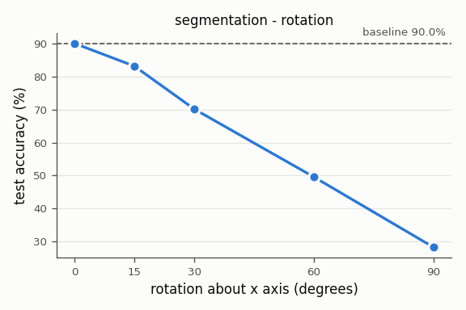
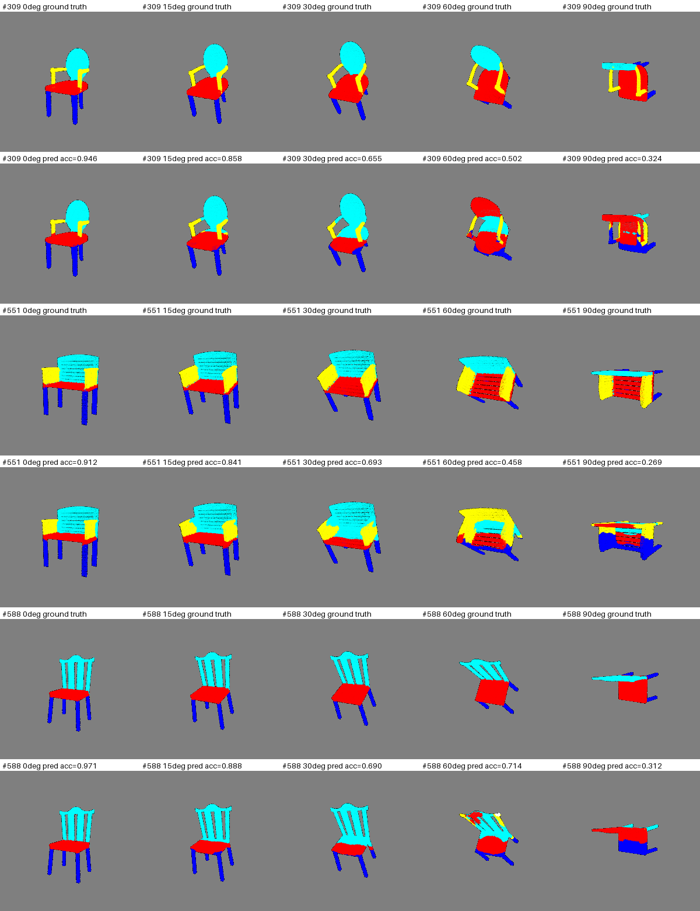
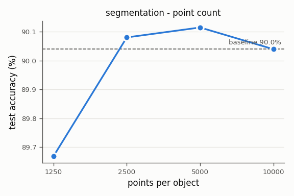
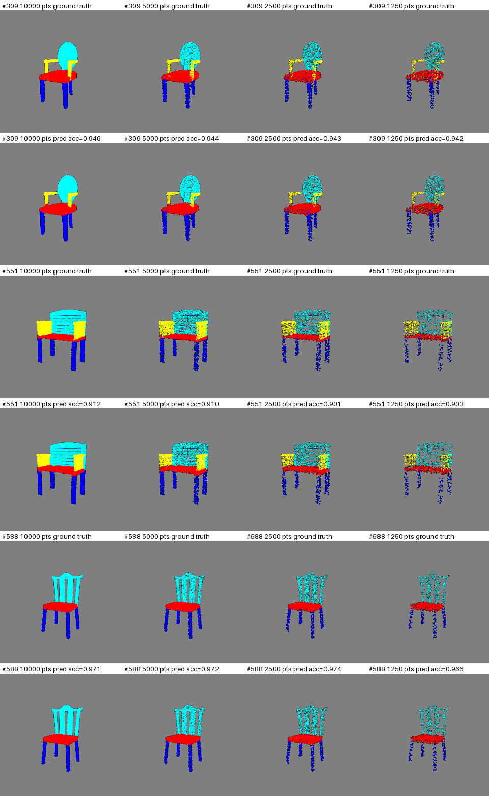

# Q3 robustness - segmentation

Baseline (no rotation, 10000 points): **0.9004**, checkpoint `./checkpoints/seg/best_model.pt` (epoch 248).

## Rotation about the x axis

| condition | points | accuracy | change (pp) |
|---|---|---|---|
| 0deg | 10000 | 0.9004 | +0.00 |
| 15deg | 10000 | 0.8316 | -6.88 |
| 30deg | 10000 | 0.7015 | -19.89 |
| 60deg | 10000 | 0.4957 | -40.47 |
| 90deg | 10000 | 0.2827 | -61.77 |

## Points per object

| condition | points | accuracy | change (pp) |
|---|---|---|---|
| 10000 pts | 10000 | 0.9004 | +0.00 |
| 5000 pts | 5000 | 0.9012 | +0.08 |
| 2500 pts | 2500 | 0.9008 | +0.04 |
| 1250 pts | 1250 | 0.8967 | -0.37 |

